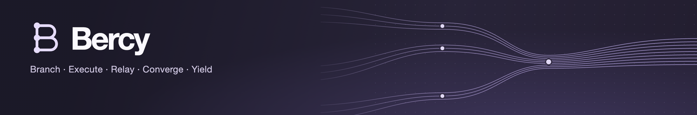
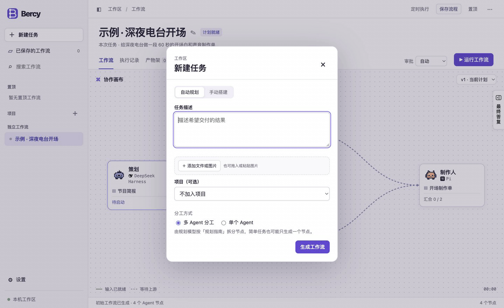
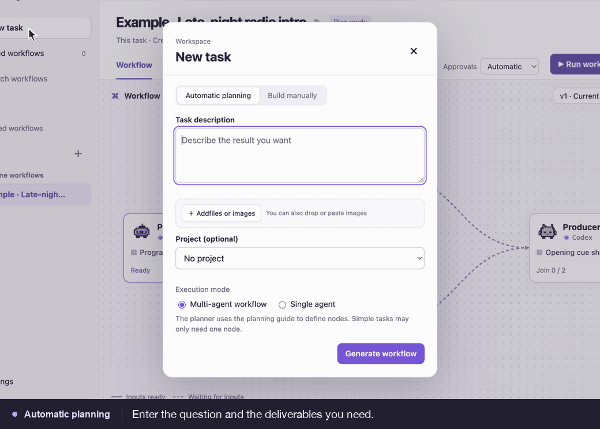
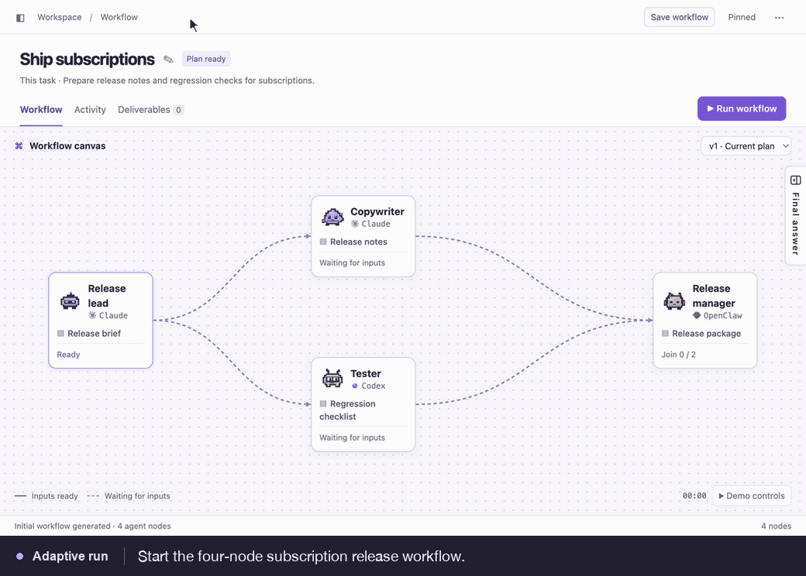
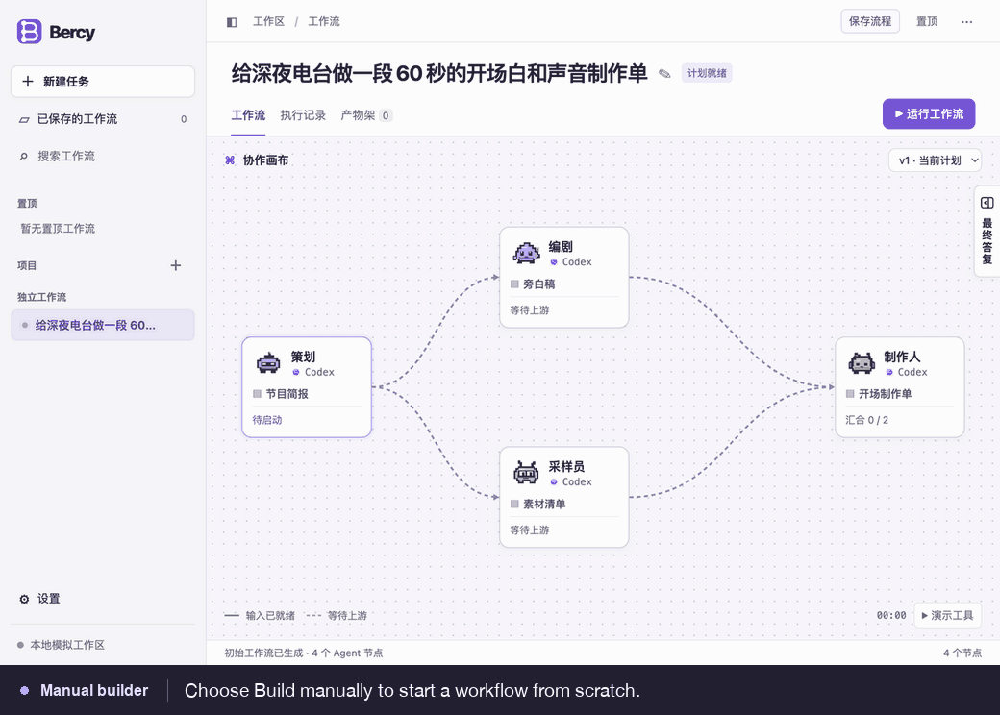

<p align="center">
  <b>一句话描述任务，百溪组建一支 AI Agent 团队：自动分工、互相审查，并在执行中按实际交付调整计划。</b><br>
  本地桌面客户端，直接调度你已经在用的 Codex、Claude Code、OpenClaw、DeepSeek Harness 和 Pi。
</p>

<p align="center">
  <a href="https://github.com/beProactive01/Bercy/releases/latest"></a>
  <a href="https://github.com/beProactive01/Bercy/actions/workflows/test.yml"></a>
  <a href="LICENSE"></a>
  
</p>

<p align="center">
  <b>简体中文</b> · <a href="README.md">English</a> · <a href="#实际效果">操作演示</a> · <a href="#快速开始">快速开始</a> · <a href="#和其他用法的区别">为什么用百溪</a> · <a href="#运行时">运行时</a>
</p>



## 你能得到什么

- **一句话，一支团队。** 写下目标，百溪规划角色、交付物和先后依赖，互不依赖的部分并行执行。不用再把上一个对话的结果复制到下一个对话里。
- **Agent 互相审查。** 审查节点发现问题会带着具体意见退回上游修改，最多两轮。审查由另一个模型执行：Codex 写的由 Claude 审，Claude 写的由 Codex 审。
- **计划会调整，不会卡死。** 节点报告受阻或有缺口时，百溪会补上缺的那一步，让依赖它的节点等待新结果。每次调整都会存为计划版本，并写明原因。
- **每一步用最合适的 Agent。** 同一个工作流里可以混用 Codex、Claude Code、OpenClaw、DeepSeek Harness、Pi 或任何兼容 ACP 的运行时。百溪按节点需要的能力自动分配，也可以逐个指定。
- **跑顺的流程留得住。** 好用的分工可以保存，下次换一份需求复用，也可以定时执行，或导出成文件分享给别人。
- **本地运行，自己掌控。** 百溪跑在你的 Mac 上，用的是你自己登录的 CLI，应用本身不发起任何网络请求。执行前可以改任何节点，命令需要你批准，哪个节点出了问题就从哪个节点重做。

## 和其他用法的区别

| | 单个 Agent 会话 | 多个 Agent 看板 | **百溪** |
| --- | --- | --- | --- |
| 谁来拆任务 | 你，一条条写提示词 | 你，一张张建卡片 | **规划器，根据一句需求** |
| 结果能否传给下一步 | 只在同一上下文里 | 不能，各干各的 | **能，产出沿依赖传递并汇合** |
| 发现缺了一步 | 你自己察觉后重来 | 你再加一张卡 | **自动补节点并记录原因** |
| 质量把关 | 你通读全部内容 | 你逐个看 diff | **另一个模型审查，不合格就退回** |
| 混用不同厂商 | 只能用一家 | 通常可以 | **按节点混用，按能力分配** |
| 复用 | 翻找旧提示词 | 重新建看板 | **带版本的流程库、定时执行、可分享的文件** |

## 实际效果

### 输入问题，自动生成工作流

输入“家庭共享功能应该如何发布？”，并说明需要发布文案、QA 清单和一份汇总简报。Codex 为前两项任务分别建立分支，再把简报接到两个分支之后。点开节点就能看到它具体要做什么。动图剪掉了等待模型的时间。



### 看工作流在执行中自行调整

在内置的订阅发版示例中，测试节点发现旧版客户端缺少覆盖。百溪给测试分支新增兼容审查节点，文案分支继续执行。发布经理等补上的检查结果到齐后，再交付完整发布包。



### 让另一个模型来审

打开只有一个上游的节点，勾选**审查节点**。审查节点要么通过，要么写明具体问题退回，上游据此修改，最多两轮。如果没有手动指定运行时，百溪会把审查交给与上游不同的已连接运行时；它正忙时会排队等待，不会改由上游的同一个模型来审。节点面板里会写明分工，例如“交叉审查：上游由 Codex 完成，改由 Claude 复核。”

```text
实现（Codex）──▶ 审查（Claude）──▶ 交付
      ▲                 │
      └── 退回：具体问题 ─┘   最多两轮
```

### 手动创建节点和连线

双击画布空白处添加节点，把 **Draft copy** 和 **QA checks** 右侧的端口分别拖到 **Launch kit** 上。移动汇总节点时，两条依赖线会跟着走。



## 快速开始

百溪目前支持搭载 Apple Silicon 的 Mac，暂不支持 Windows 和 Intel Mac。

[下载 Bercy 安装包（Apple Silicon，.dmg）](https://github.com/beProactive01/Bercy/releases/download/v0.1.14/Bercy-0.1.14-arm64.dmg)，其他版本见 [Releases](https://github.com/beProactive01/Bercy/releases)。打开磁盘映像，把 Bercy 拖到「应用程序」。

应用还没有经过公证，第一次打开会被 macOS 拦下。在终端运行一次下面的命令，之后就能正常打开：

```sh
xattr -dr com.apple.quarantine /Applications/Bercy.app
```

也可以先尝试打开一次，再到 **系统设置 → 隐私与安全性** 点击 **仍要打开**。

从源码运行需要 Node.js 和 npm，项目已在 Node.js 26.5 下测试。

```sh
npm ci
npm start
```

1. 打开 **设置 → 运行时**，连接至少一个已安装并登录的本机 CLI。连上两个运行时，审查就能交给另一个模型。
2. 点击 **新建任务 → 多 Agent 分工**，输入一句需求：

   > 为记账 App 的订阅功能准备上线说明和回归清单。

3. 在画布上看各节点执行，点开节点可以查看实际提示词和产物，最终交付显示在画布右侧。

想在开跑前先检查计划，可以在 **设置 → 执行** 关闭自动运行。也可以选「单个 Agent」跳过规划，或从空白画布手动搭建。

## 保存、定时与分享

- **保存。** 点击 **保存流程**。「只存流程结构」保留角色、依赖、交付要求和运行时设置，下次按新需求重新生成任务简述；「完整保存」连每个节点的简述一起保留。用同一名称再次保存会新增一个版本。
- **定时。** 打开工作流，点击 **定时执行**。百溪会记下当前节点、任务描述和输入附件，可以按本机时间执行一次、每隔几小时、每天或每周执行，每次触发都会生成独立的运行记录。请保持百溪打开，最小化也可以。电脑休眠或应用退出后，恢复时会补跑最近一次错过的执行。
- **分享。** 在 **已保存的工作流** 中点击 **导出**，生成 `.bercy.json` 文件；点击 **导入**，把别人分享的流程加入流程库。文件只包含流程定义，不含历史任务描述、产物或附件。完整保存的流程会带上各节点的简述，分享前请检查。导入的文件会先校验，再重新构建。

## 运行时

| 运行时 | 本机入口 | 接入方式 |
| --- | --- | --- |
| Codex | `codex` | app-server，支持图片、流式输出和执行中追加指示 |
| Claude Code | `claude` | stream-json，支持图片和工具事件 |
| OpenClaw | `openclaw` | 通过 CLI 调用已配置的 Gateway |
| DeepSeek Harness | `dsh acp` | 通过 Agent Client Protocol 建立会话 |
| Pi | `pi` | JSON 事件流，支持图片；只有需要执行命令的节点才开放命令能力 |

设置页支持添加其他兼容 ACP 的运行时。每个运行时默认同时执行 2 个节点，可调为 1–4 个。百溪按节点需要的能力（写文件、执行命令、联网）分配运行时，你也可以逐个指定。

## 工作原理

点击侧栏「项目」旁的 **＋ → 添加目录**，可以把已有代码仓库设为项目目录。点击项目名旁的 **＋** 发起任务，直接读取、修改和测试其中的文件。可在「管理项目」更换目录，已经启动的工作流继续使用原目录。

工作流状态和执行记录保存在本机 SQLite 中。提示词只发给你连接的运行时，使用的是你自己的账号。做软件项目时，各节点在同一个项目目录里按各自负责的路径分工；项目节点全部完成后，会按你的审批设置执行项目的验收命令。

```sh
npm test              # 运行测试
npm run package:mac   # 打包 Apple Silicon 版应用和 DMG，输出到 build/
```

用 `npm run test:regression` 运行真实 Codex 回归集。只测代码开发、修改和测试生成时，运行 `npm run test:regression -- coding`。[回归集说明](regression/README.md)

[规划指南](desktop/planning-guide.md) · [工作流机制与提示词](工作流机制与提示词.md) · [提示词实现](desktop/prompts.cjs) · [桌面主进程](desktop/) · [画布与调度](dist/)

## 参与贡献

欢迎提交问题报告、新的运行时适配和工作流文件。开发环境和提交要求见 [CONTRIBUTING.md](CONTRIBUTING.md)。

## 许可证

[MIT](LICENSE)。可以自由使用、修改和再发布，包括商用，只需保留版权声明。

---

<p align="center"><b>Bercy = Branch · Execute · Relay · Converge · Yield</b><br>
百溪，取百川汇流之意。分支、执行、交接、汇合，最后交付一份成果。</p>
